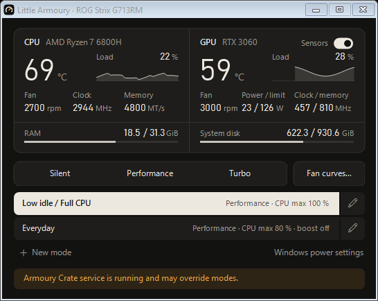

# Little Armoury

A small native Windows app for ASUS operating modes, fan curves and hardware stats.



## Download

**[Download LittleArmoury.exe](https://github.com/botkooper/little-armoury/releases/latest/download/LittleArmoury.exe)** and run it. There is no installer.

You need Windows 10 or 11 and the ASUS System Control Interface driver. GPU readings need the NVIDIA driver.

Tested on an ASUS ROG Strix G713RM (Ryzen 7 6800H, RTX 3060, BIOS G713RM.327). Other ASUS models and running without Armoury Crate installed are untested.

## What it does

- CPU and GPU temperature, load, clocks, fan RPM and GPU power; RAM and system-drive usage.
- Silent, Performance and Turbo presets. Turbo needs the power adapter.
- Eight-point CPU and GPU fan curves. Choosing a preset restores the factory curves.
- Custom modes: a preset plus a maximum CPU performance percentage and a boost switch.
- Minimizes to the system tray.

## Good to know

- A custom mode runs on a temporary copy of your Windows power plan. Choosing a preset or quitting restores your plan.
- Lowering maximum CPU performance can cut game performance substantially.
- A running Armoury Crate service can override the mode you pick.
- The firmware does not report its current mode, so no preset is highlighted until you choose one.
- Reading GPU sensors can keep the NVIDIA GPU awake. Turn off **Sensors** in the GPU panel to stop it.
- Armoury Crate's Windows mode is not available.
- Custom modes are saved in `%LOCALAPPDATA%\LittleArmoury`.

## Build and test

Needs only .NET Framework 4.8. The executable is written to `dist\LittleArmoury.exe`.

```powershell
powershell.exe -NoProfile -ExecutionPolicy Bypass -File .\build.ps1
powershell.exe -NoProfile -ExecutionPolicy Bypass -File .\test.ps1
```

Add `-LivePowerPolicy` to `test.ps1` to also test against real Windows power plans. It briefly switches your power plan, so close Little Armoury first. Preset and fan-curve writes to the firmware have no automated tests.

To write a read-only hardware report:

```powershell
.\dist\LittleArmoury.exe --diagnostics diagnostics.txt
```

The ASUS protocol can be checked against the Linux kernel's `drivers/platform/x86/asus-wmi.c` and `include/linux/platform_data/x86/asus-wmi.h`.

## License

[MIT](LICENSE)
